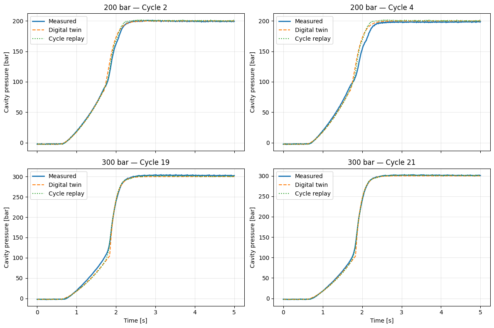
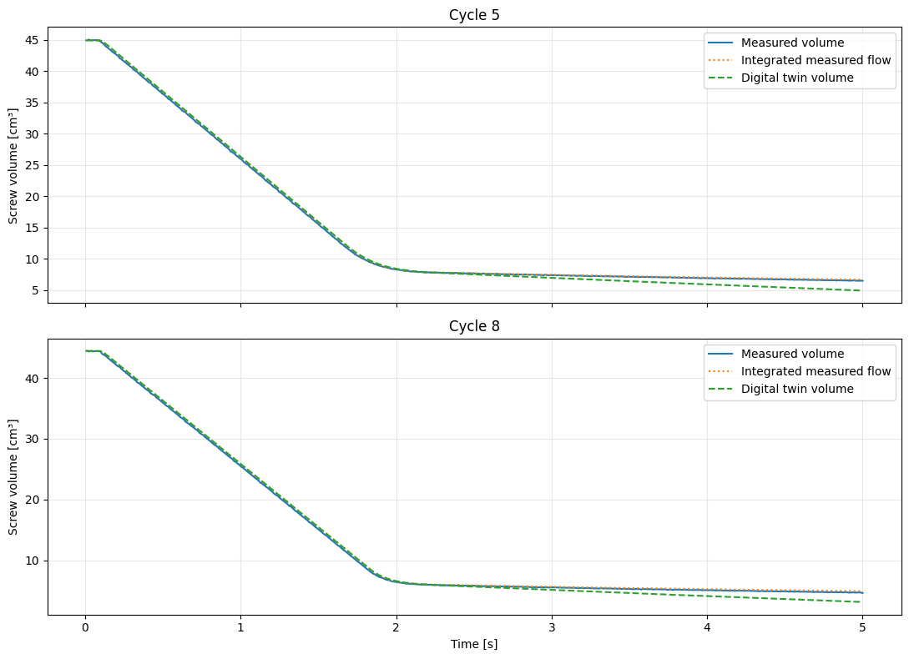
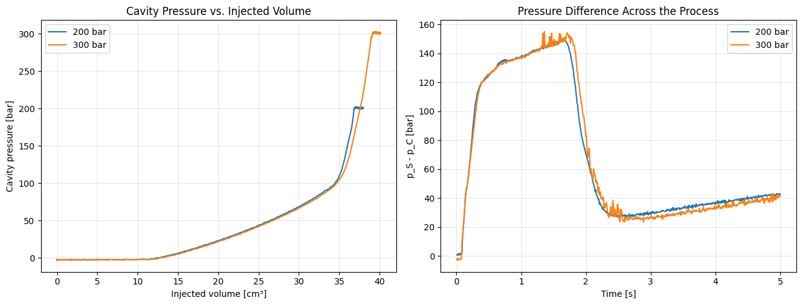

# Building a digital twin of an injection molding process

**A control-to-pressure simulation using real injection-molding measurements from RWTH Aachen.**  
*System identification · Volume conservation · Hybrid dynamics · Cross-experiment validation*

I started with a simple question: **can a small, explainable model reconstruct cavity pressure from the injection machine's recorded controller output?** Instead of fitting one opaque regression to pressure, I built and tested the chain from voltage to screw flow, from flow to displaced volume, and from volume to cavity pressure. The pressure-control phase needed a different dynamical model, which made the final system hybrid.

The model works as an **offline, recorded-input simulation**. It is not an independently controlled virtual machine, and it does not predict the effect of arbitrary new voltage commands. The results are useful precisely because that distinction—and the baselines that beat the model—remains visible.



*Frozen-model evaluation on four further Figure 8 experiments. The digital twin follows the main filling and pressure-control dynamics, but cycle replay is more accurate on all four tests.*

## The result, before the method

The final model was calibrated using Figure 10 experiments and evaluated on four additional cycles from a separate Figure 8 series. The evaluation window was the first **0–5 seconds**, covering injection and pressure holding but not the later pressure-release and screw-return phases.

| Later experiment | Cycle replay RMSE | Hybrid twin RMSE |
|:--|--:|--:|
| 200 bar · cycle 2 | **2.064 bar** | 3.410 bar |
| 200 bar · cycle 4 | **5.279 bar** | 5.732 bar |
| 300 bar · cycle 19 | **3.756 bar** | 4.992 bar |
| 300 bar · cycle 21 | **1.726 bar** | 3.266 bar |
| **Mean of four cycles** | **3.206 bar** | **4.350 bar** |

**The replay baseline wins every final comparison.** This study is not a claim that a digital twin is always a better pressure predictor. It is an example of identifying, connecting, and challenging physical and empirical submodels—and reporting where they stop being useful.

### Where the model genuinely helped

The useful results were not confined to the pressure RMSE:

- **Controller output → screw flow.** In the deceleration window, a **22.75 ms pure-delay model**, fitted on one 200 bar cycle, beat a static voltage–flow map on five additional cycles. It also performed marginally better than a one-parameter first-order lag. The two are not cleanly distinguishable as physical mechanisms at an 8 ms sample interval.
- **Volume conservation.** The measured signals were consistent with $dV_S/dt=-v_S$ (about **0.2005 cm³ RMSE** on the first checked cycle). That is a consistency check, not independent sensor validation.
- **A bias exposed by integration.** A model with good flow RMSE drifted **1.4–1.7 cm³** by the end of a cycle. Most of that error came from a ~**0.63 cm³/s** holding-flow overestimate. Correcting the *calibration point*, rather than adding dynamics, reduced end-volume errors to roughly **0.22–0.41 cm³**.
- **A hybrid pressure response.** Treating filling and packing separately improved upon the first single-regime pressure model. No one packing model order won at both 200 and 300 bar.



*The original flow model almost overlaps with the measurements during filling. Its small holding-flow bias accumulates into a persistent volume offset. The revised two-point calibration is reported in the notebook and the technical notes.*

## How the digital twin is assembled

The input is the **controller output recorded by the actual closed-loop system**, $u_S(t)$. The model is calibrated on Figure 10 data, and the resulting states evolve without feeding back measured test-cycle flow or cavity pressure.

```text
Recorded controller output, u_S(t)       Known pressure target
               │                                  │
        Calibrated flow map                        │
       + startup + time delay                      │
               │                                  │
        Estimated screw flow                       │
               │                                  │
      Integrate displaced volume                   │
               │                                  │
         Filling-pressure law                      │
               │                                  │
            Regime switch ──────────────── Packing dynamics
               └──────────────────────┬───────────┘
                                      │
                            Estimated cavity pressure
```

Three compact relations carry most of the model:

$$
\hat v_S(t)=g_{\mathrm{start}}(t)\,q_{\mathrm{eq}}\!\left(u_S(t-L)\right),
\qquad
\frac{d\hat F}{dt}=\hat v_S,
$$

$$
\hat p_{\mathrm{fill}}=p_0+a\max(\hat F-F_0,0)^b.
$$

During packing, the estimated pressure follows a **first-order or critically damped second-order effective closed-loop response** to the known pressure target. The choice is conditional on the operating point, based on the earlier Figure 10 analysis: second order at 200 bar, first order at 300 bar.



*The early pressure–volume relationship is similar, but the rapid pressure build-up and switching region differ. That observation motivated the hybrid architecture.*

## The experiments that changed the model

This repository keeps the false starts. They explain the final design better than a polished model presented without context.

| Investigation | What happened | Engineering decision |
|:--|:--|:--|
| Single first-order pressure model | ~8 bar RMSE at 200 bar; **15–20 bar** at 300 bar | Do not treat screw and cavity pressure as a single lag |
| Previous-cycle pressure replay | **0.659–2.775 bar** at 200 bar, better than the first model | Keep a strong reference in every comparison |
| Filling pressure vs. injected volume | Cycle 4: **0.479 bar** filling RMSE; 300 bar errors rose near the switch | Separate filling from pressure regulation; note extrapolation |
| First- vs. second-order packing | Second order helped at 200 bar; first order won at 300 bar after fair recalibration | Do not assume higher order means better |
| $C^1$ pressure/derivative continuity | Better mathematical continuity, inconsistent RMSE benefit | Retain it as a tested alternative, not the final choice |
| Voltage–flow static / lag / delay | Pure delay slightly best across five cycle tests | Choose a simple, supported empirical model |
| Whole-cycle flow integration | Small holding-flow error made volume drift | Correct the operating-point anchoring |
| Different experimental series | Main trends transferred, but **cycle replay still won** | State the model's scope and limitations |

The [engineering notes](docs/ENGINEERING_NOTES.md) contain the derivations, discarded hypotheses, parameter estimates, representative Python code, and the complete numeric experiment ledger. The notebook preserves the runnable research path, not just the chosen final model.

## Run the notebook

**1. Get the experiment archive.** Download **`ExperimentalData.zip`** from the [RWTH Aachen source record](https://publications.rwth-aachen.de/record/1016199). The published data are **CC BY-NC 4.0**; the raw archive is intentionally not included here. The RWTH site may present a browser security challenge to automated downloads, so use the file link through a regular browser.

**2. Open [`Injection_Molding_Digital_Twin.ipynb`](Injection_Molding_Digital_Twin.ipynb)** in Google Colab and run the cells in sequence. The first cell will request the archive if it is not already in the working directory. For local Jupyter, install dependencies from [`requirements.txt`](requirements.txt) and put the ZIP beside the notebook or in the active working directory.

**3. Follow the investigation.** The notebook retains saved results from the original Colab run for inspection on GitHub. Running it again requires the experimental archive. The fully unedited exploration is kept in [`archive/Untitled1_original.ipynb`](archive/Untitled1_original.ipynb) so the rejected models and raw trial sequence are not lost.

### Repository guide

| File | Purpose |
|:--|:--|
| [`Injection_Molding_Digital_Twin.ipynb`](Injection_Molding_Digital_Twin.ipynb) | Main Colab notebook: cleaned execution order, saved plots and explanatory Markdown |
| [`docs/ENGINEERING_NOTES.md`](docs/ENGINEERING_NOTES.md) | Mathematical background, modelling choices, experiment history and code excerpts |
| [`figures/`](figures/) | Figures exported from actual notebook outputs, not illustrative curves |
| [`archive/Untitled1_original.ipynb`](archive/Untitled1_original.ipynb) | Unchanged 57-cell research notebook |
| [`data/README.md`](data/README.md) | Dataset provenance, access instructions and licensing |

## What the results do—and do not—establish

**Supported:** on selected recorded closed-loop injection/packing cycles, a small model can reconstruct screw flow, displaced volume, and the main cavity-pressure profile using measured controller output and known pressure target. Transferring the frozen model to another experimental series yielded repeatable but imperfect pressure traces. A simple same-setpoint replay was a better final pressure predictor.

**Not established:** accurate responses to *new* control voltages, the independent voltage-to-plant transfer function, a real-time digital twin connected to a PLC, the entire ~25 s process including screw return, performance on unseen materials or machines, or a guaranteed pressure-optimization benefit. The Figure 8 family was explored before choosing the 0–5 s evaluation window; the four later cycles were kept out of fitting, but this is not a fully pre-registered industrial trial.

---

**Data credit:** RWTH Aachen University, *Injection Molding Process Data for Post-Consumer-Recycled Materials*; experimental work described in the accompanying research publication, *Part-mass control in injection molding of recycled thermoplastics by learning-enabled model predictive cavity-pressure control*. The source README identifies J. Ahlers, R. Goellinger and M. Mascher among the investigator contacts. Experimental data: [official RWTH record](https://publications.rwth-aachen.de/record/1016199). The dataset's CC BY-NC 4.0 license applies to its underlying data, not automatically to the author's analysis code.
