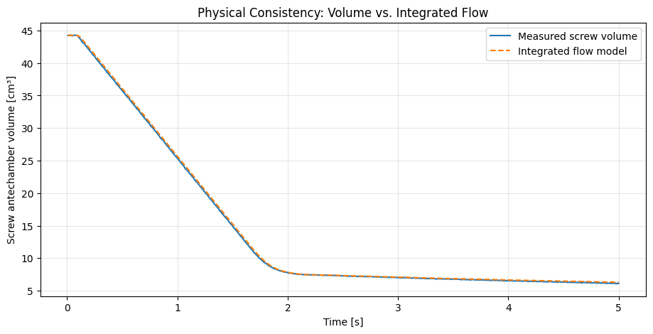
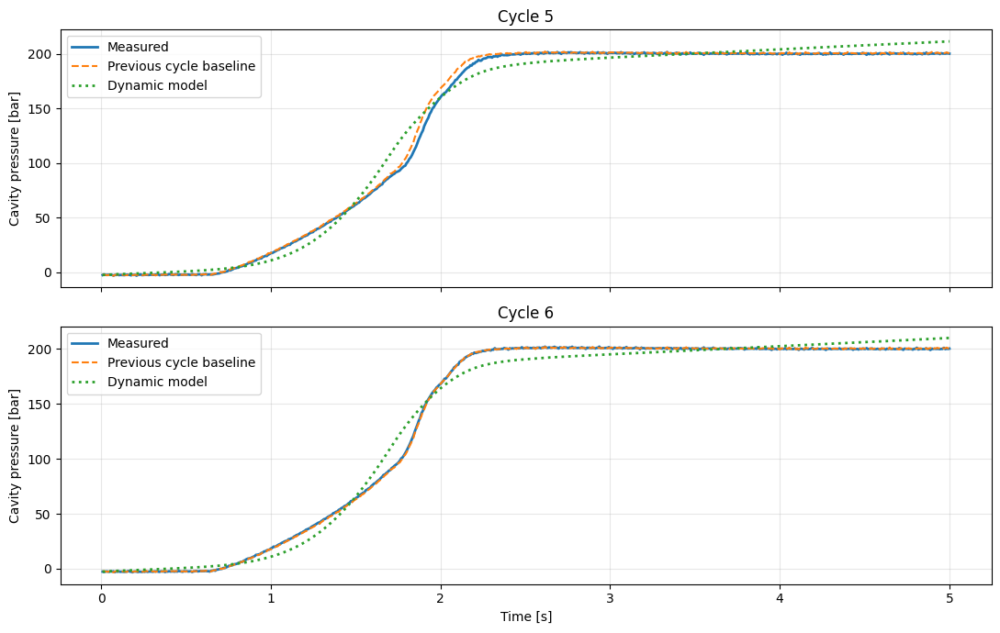
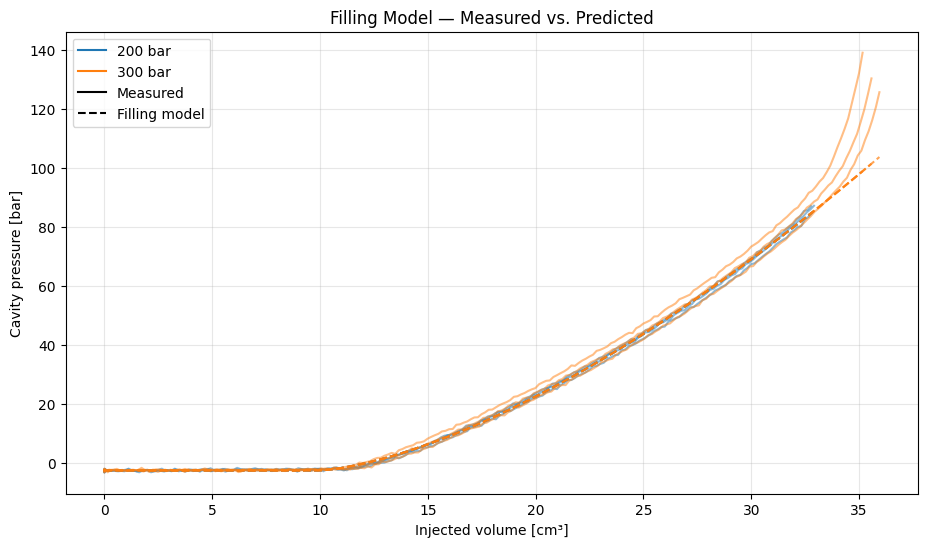
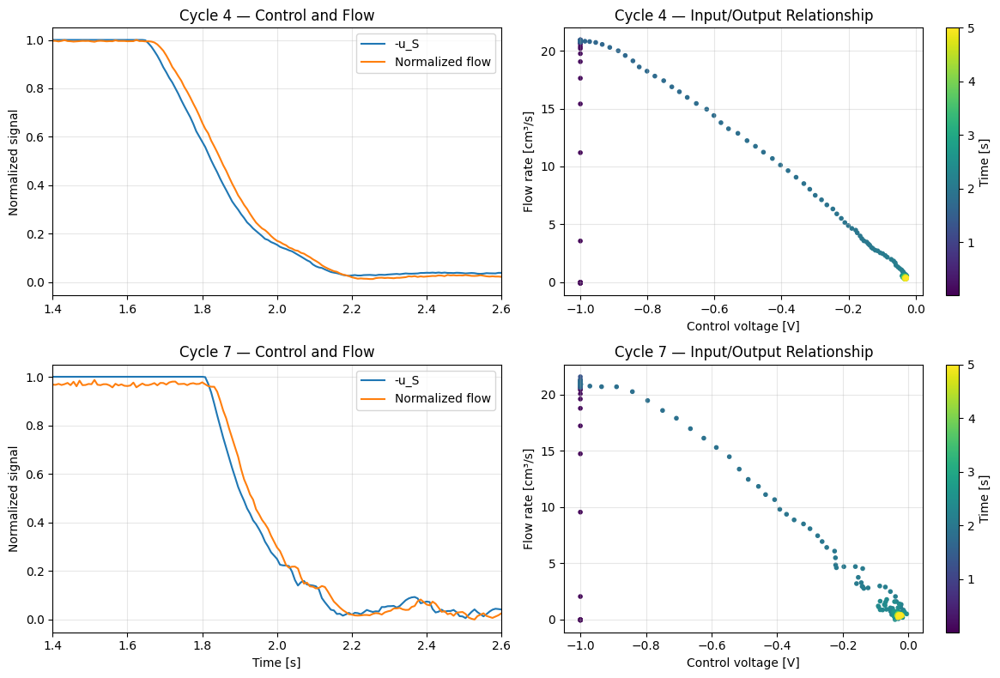
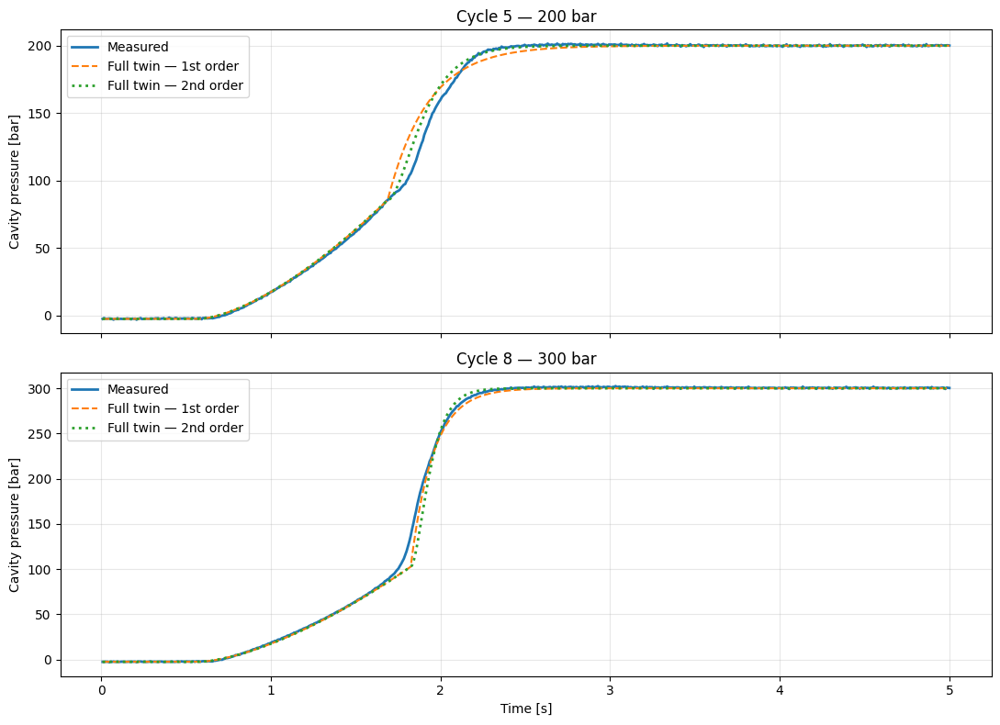

# Engineering notes

## A reduced-order injection-molding twin, built and challenged step by step

This is the long version of the project. The [README](../README.md) shows what came out of it; the [Colab notebook](../Injection_Molding_Digital_Twin.ipynb) contains the working experiments. These notes explain *why* the equations were chosen, where their assumptions came from, and why some promising-looking models were rejected.

The sequence matters. We did not begin knowing that the voltage–flow relation would behave like a short delay, that volume drift would be dominated by holding flow, or that cycle replay would beat the final cavity-pressure model. Those findings drove the next experiment each time. I have kept the negative results rather than rewriting the investigation as though the final answer had been obvious.

## 1. The process and the data

The source is [RWTH Aachen's *Injection Molding Process Data for Post-Consumer-Recycled Materials*](https://publications.rwth-aachen.de/record/1016199). The experiment README describes injection-molding tests with post-consumer-recycled and virgin polypropylene, an Arburg Allrounder 520 A 1500-800 machine, and cavity-pressure control using proportional and learning-based predictive strategies. Our notebook focuses on the provided Figure 10 *followingBehavior* and Figure 8 *againstDisturbance* traces, not part-mass optimisation.

Each selected trace has the same six columns:

| Column | Meaning | Unit |
|:--|:--|:--|
| `time` | Recorded time | s |
| `p_C` | Cavity pressure | bar |
| `p_S` | Screw-antechamber pressure | bar |
| `v_S` | Injection **volumetric flow** (called $Q_S$ in the final publication) | cm³/s |
| `V_S` | Volume of the screw antechamber | cm³ |
| `u_S` | Screw control voltage / controller output | V |

The Figure 10 files each cover about 5 seconds at approximately **8 ms** sampling. Figure 8 runs longer (about **23–25 seconds**), continuing through pressure release and later negative-flow / screw-return-like behaviour. Those later phases are **outside** the scope of the present model.

### Experiment design and leakage boundaries

- **Initial system identification:** Figure 10, 200 bar, cycle 4.
- **First repeatability checks:** Figure 10, 200 bar, cycles 5 and 6.
- **Operating-point exploration and eventual packing calibration:** Figure 10, 300 bar, cycles 7, 8 and 9. Cycle 7 is later used for 300 bar packing time constants.
- **Different experimental series, inspected to establish scope:** Figure 8, cycle 1 at 200 bar and cycle 18 at 300 bar.
- **Further evaluation under a frozen model/window:** Figure 8, cycles 2 and 4 (200 bar), cycles 19 and 21 (300 bar).

These are *cycle-level* divisions, not a random train/test split over individual timestamps. Randomly splitting samples from the same physical cycle would yield misleadingly optimistic errors. Still, the Figure 10 repeat cycles were examined throughout development, and the Figure 8 family/window was inspected before the last four-cycle check. We therefore describe this as **cross-experiment evaluation with a frozen model**, not fully blind or externally certified validation.

The controller voltage is a **feedback controller output**, not an independently excited plant input. This distinction is the most important limitation of any later “what-if” claim.

## 2. Start with a conservation relation

Before fitting pressure, we checked whether screw flow and antechamber volume were consistent:

$$
\frac{dV_S}{dt}=-v_S(t)
\quad\Longrightarrow\quad
\hat V_S(t)=V_S(0)-\int_0^t v_S(\tau)\,d\tau.
$$

For sampled data, the trapezoidal approximation is

$$
\hat V_{k+1}=\hat V_k-
\frac{v_{S,k}+v_{S,k+1}}{2}(t_{k+1}-t_k).
$$

```python
from scipy.integrate import cumulative_trapezoid

V_from_flow = V_measured[0] - cumulative_trapezoid(
    q_measured, t, initial=0
)
```

On the first 200 bar cycle, the integrated-flow reconstruction ended at **6.292 cm³**, compared with the measured **6.126 cm³**; the full-curve RMSE was **0.2005 cm³**. That is a useful sign check and an internal consistency test. It is **not** proof of independent measurement accuracy: the reported flow may be obtained from screw displacement, so the two channels could share a source.



## 3. The first pressure model was not competitive

We first tried to use the screw-side pressure $p_S$ to drive a cavity-pressure state through a filling gate:

$$
\tau\dot{\hat p}_C
=g(F)\max(p_S-\Delta p,0)-\hat p_C,
\qquad
F(t)=\int_0^t v_S(\tau)\,d\tau,
$$

$$
g(F)=\frac{1}{1+\exp[-(F-F_{50})/w]}.
$$

Four parameters were identified by least squares on Figure 10, cycle 4:

| Parameter | Fit | Interpretation caveat |
|:--|--:|:--|
| $F_{50}$ | 27.7147 cm³ | Midpoint of an empirical pressure-transfer gate; **not** measured cavity fill fraction |
| $w$ | 5.2827 cm³ | Gate width |
| $\Delta p$ | **0.0000 bar** | Hit the lower bound: warning of model mismatch / parameter confounding |
| $\tau$ | 0.2787 s | Effective pressure response lag |

A sample-by-sample exact first-order update, with the right-hand forcing held constant over one sample interval, kept the simulation simple:

```python
alpha = np.exp(-(t[k + 1] - t[k]) / tau)
p_hat[k + 1] = alpha * p_hat[k] + (1 - alpha) * p_eq[k]
```

The fit looked plausible on the 200 bar graph but struggled through the rapid rise and drifted toward screw pressure during the holding plateau. More damning, a **cycle replay** baseline was much better:

| 200 bar test | Single-regime RMSE | Replay of cycle 4 |
|:--|--:|--:|
| Cycle 5 | 8.043 bar | **2.775 bar** |
| Cycle 6 | 7.696 bar | **0.659 bar** |

At 300 bar, the unchanged model gave **15.019, 17.083, 20.469 bar** RMSE on cycles 7–9. Keeping this negative result was essential: a sophisticated-looking differential equation is not useful merely because its fitted curve resembles the experiment.



## 4. Observe the regime switch before inventing another model

The pressure-versus-volume plot showed two recognisable behaviours. Early in filling, 200 and 300 bar experiments shared almost the same cavity-pressure rise as displaced volume increased. Near the end, the response accelerated toward different pressure targets, and the controller output moved away from its $-1$ V level.

We measured three event times: when `u_S` first exceeded −0.9 V after 1 second, when flow first fell below 90% of its maximum after 1 second, and when cavity pressure first reached 100 bar. Those are **event-detection heuristics**. They are not ground-truth control mode bits.

For six Figure 10 cycles, the measured control-change to flow-drop lag was **24–32 ms**, with an average of **26.7 ms**. More importantly, the transition occurred around **33 cm³** for the 200 bar setpoint but **35–36 cm³** for 300 bar. The 100 bar crossing occurred *after* the voltage-change event at 200 bar and *before* it at 300 bar. A fixed time, fixed displaced volume or a universal 100 bar switching condition would not describe all the records.


The working hybrid model uses the *recorded* voltage threshold to locate $t_s$. That is an explicit concession: the switch is replayed from the measured control history, not autonomously generated from a validated state machine.

## 5. The filling branch

The reduced-order filling relation is

$$
\hat p_{\mathrm{fill}}(F)=p_0+a\max(F-F_0,0)^b.
$$

The fitted parameters, using **only the pre-switch part of Figure 10 / 200 bar / cycle 4**, were

$$
p_0=-2.553\ \mathrm{bar},\quad
a=0.7363\ \frac{\mathrm{bar}}{(\mathrm{cm}^3)^{1.525}},\quad
F_0=9.8834\ \mathrm{cm}^3,\quad b=1.5250.
$$

`F0` is the fitted onset of measurable pressure in this formula, **not** independently measured cavity volume. `p0` includes the observed pressure-sensor offset; slightly negative pre-fill readings are not treated as literal negative absolute melt pressure.

| Figure 10 cycle | Filling RMSE (measured flow) |
|:--|--:|
| 200 bar · 4 (fit) | 0.479 bar |
| 200 bar · 5 | 1.067 bar |
| 200 bar · 6 | 0.672 bar |
| 300 bar · 7 | 2.746 bar |
| 300 bar · 8 | 3.677 bar |
| 300 bar · 9 | 5.910 bar |

The 300 bar errors increase near the switch; those records take the model beyond the approximately 33 cm³ region on which the 200 bar filling law was fitted. This is **extrapolation plus potentially different control behaviour**, not proof of a particular material mechanism.



## 6. Packing dynamics, in the order we tried them

### First order

The first packing candidate is a known-setpoint, *closed-loop* model:

$$
\tau_p\frac{d\hat p_C}{dt}=p_{\rm ref}-\hat p_C,
\qquad
\hat p_C(t)=p_{\rm ref}+
[\hat p_C(t_s)-p_{\rm ref}]e^{-(t-t_s)/\tau_p}.
$$

A single fit on 200 bar cycle 4 gave **$\tau_p=0.2384$ s**. Used unchanged at 300 bar, the hybrid RMSE remained **11–16 bar**. The normalized experimental pressure rise was not a simple first-order exponential; in several cycles it began more slowly and then rose rapidly.

Define the normalized pressure response by

$$r(t)=\frac{p_C(t)-p_C(t_s)}{p_{\rm ref}-p_C(t_s)}.$$

For a textbook first-order step response, $t_{63}=\tau$ and $t_{90}=\tau\ln(10)$, so $t_{90}/t_{63}\approx2.303$. In the recordings, the ratios were about **1.61–2.00**, depending on operating point. These times are relative to a threshold-based controller event, so they are *descriptors*, not independently identified plant time constants.

### Second order

The next candidate is critically damped:

$$
\tau^2\ddot p_C+2\tau\dot p_C+p_C=p_{\rm ref}.
$$

We initially used the special solution with **zero derivative at the switch**:

$$
\hat p_C(t)=p_{\rm ref}+(p_s-p_{\rm ref})(1+z)e^{-z},
\qquad z=(t-t_s)/\tau.
$$

To compare orders fairly, both were later allowed **one packing time constant per working point**, fitted on cycle 4 (200 bar) and cycle 7 (300 bar):

| Closed-loop response | 200 bar $\tau$ | 300 bar $\tau$ |
|:--|--:|--:|
| First order | 0.2384 s | 0.1326 s |
| Second order | 0.1174 s | 0.0635 s |

This gave the following RMSE for *other Figure 10 cycles*:

| Cycle | First order | Second order | Replay |
|:--|--:|--:|--:|
| 200 bar · 5 | 5.592 | **3.589** | **2.775** |
| 200 bar · 6 | 4.033 | **1.497** | **0.659** |
| 300 bar · 8 | **3.796** | 5.935 | **2.932** |
| 300 bar · 9 | **6.355** | 8.177 | 8.677 |

Second order helped at 200 bar but hurt at 300 bar. The data do not justify claiming one universally superior model order.

### The $C^1$ alternative

There was a genuine mathematical inconsistency in the second-order candidate: the filling model entered packing with a nonzero pressure slope, but the zero-slope packing solution reset it to zero. Differentiating the filling relation by the chain rule gives

$$
\dot p_{\mathrm{fill}}(t_s)=ab(F_s-F_0)^{b-1}v_S(t_s),\quad F_s>F_0.
$$

A critically damped solution respecting the initial slope $\dot p_s$ is

$$
\hat p_C(t)=p_{\rm ref}+(A+B\Delta t)e^{-\Delta t/\tau},
\quad A=p_s-p_{\rm ref},\quad B=\dot p_s+\frac{A}{\tau}.
$$

This satisfies continuity of both $p$ and $\dot p$. Its RMSE on cycles 5, 6, 8, 9 was **3.876, 1.845, 5.772, 8.067 bar**, respectively. It did not improve the 200 bar results, so $C^1$ continuity remained a documented hypothesis rather than the selected solution. Physical pressure derivatives can also change abruptly across controller modes; smoothness was not a guaranteed physical requirement.

## 7. Identify the actuator instead of feeding measured flow into the model

Until this point, pressure simulations required the *measured* $v_S$. We wanted to predict it from the recorded $u_S$. A whole-cycle static model could not work: in the first few samples, $u_S\approx-1$ V while $v_S\approx0$; during established filling, $u_S\approx-1$ V while $v_S\approx20.8$ cm³/s. The missing ingredient is at least a startup state/event.

The deceleration period is more informative: voltage and flow change together. The first equilibrium flow map interpolated linearly between filling and holding levels:

$$
q_{\rm eq}(u)=q_{\min}+(q_{\max}-q_{\min})\operatorname{clip}(-u,0,1).
$$

Fitted on cycle 4, $q_{\max}\approx20.831$ cm³/s and $q_{\min}\approx0.386$ cm³/s. We tested three models, without tuning them on cycles 5–9:

1. **Static:** $\hat q(t)=q_{\rm eq}(u_S(t))$.
2. **First-order lag:** $\tau_v\dot{\hat q}+\hat q=q_{\rm eq}(u_S)$, with $\tau_v=17.5$ ms.
3. **Pure delay:** $\hat q(t)=q_{\rm eq}(u_S(t-L))$, with $L=22.75$ ms.

For the first-order model, the sample update is

```python
alpha = np.exp(-dt / tau_v)
q_next = alpha * q_now + (1 - alpha) * equilibrium_flow(u[k])
```

For the pure delay, voltage is interpolated at shifted timestamps:

```python
voltage_lagged = np.interp(t - delay, t, u)
q_hat = equilibrium_flow(voltage_lagged)
```

In the post-switch region up to 2.6 s, pure delay slightly beat first order on all five repeat-cycle checks:

| Figure 10 cycle | Pure-delay RMSE | First-order RMSE |
|:--|--:|--:|
| 5 | **0.445** | 0.449 |
| 6 | **0.466** | 0.480 |
| 7 | **0.472** | 0.496 |
| 8 | **0.493** | 0.510 |
| 9 | **0.518** | 0.536 |

All values above are cm³/s. The differences are small relative to the **8 ms** sampling interval. We prefer the simpler one-parameter delay for this dataset; we do **not** claim to have isolated the physical transport delay from filtering, feedback effects, or actuator dynamics.



### Startup is an inferred envelope

The entire recorded cycle needs a start-up term because voltage alone does not signal the onset:

$$
g_{\rm start}(t)=
\begin{cases}
0,&t<t_{\rm on},\\
1-\exp[-(t-t_{\rm on})/\tau_{\rm start}],&t\ge t_{\rm on}.
\end{cases}
$$

The cycle-4 startup fit gave $t_{\rm on}=0.0933$ s and $\tau_{\rm start}=0.0141$ s. This is a **surrogate for a missing enable/machine-state signal**, not a measured PLC bit. Combined with the lagged voltage map, it reproduced all six Figure 10 full-cycle flow traces with roughly **0.48–0.57 cm³/s RMSE**.

## 8. The most revealing mistake: holding-flow calibration

When integrated into predicted screw volume, the first full-cycle flow model consistently ended **1.4–1.7 cm³ below** the measured volume. Plots made the filling portions look nearly identical; the drift accumulated after ~2.3 s.

We calculated the integrated flow error by phase:

$$E_V(t_1,t_2)=\int_{t_1}^{t_2}[\hat v_S(t)-v_S(t)]\,dt.$$

For all six Figure 10 cycles, holding flow was measured near **0.38–0.43 cm³/s**, but the model gave roughly **1.01–1.05 cm³/s**. This ~0.63 cm³/s bias over 2.7 seconds accounted for about **1.7 cm³** accumulated flow error. The filling-window integrated errors, by comparison, were between roughly −0.16 and +0.02 cm³.

The problem was not integration. It was the initial linear map's reference point. We had set $q_{\min}$ equal to a flow measured near **$u=-0.032$ V** but treated it as the flow at **$u=0$ V**. With a 20.8 cm³/s range, that small voltage offset matters.

Rather than adding a “deadband” parameter and telling a physical story the measurements could not prove, we simply re-anchored the same linear map at two *observed* points:

$$
q_{\rm eq,new}(u)=q_{\rm hold}+
(q_{\max}-q_{\rm hold})
\operatorname{clip}\left(\frac{u_{\rm hold}-u}{u_{\rm hold}+1},0,1\right).
$$

For cycle 4, $u_{\rm hold}=-0.03221$ V and $q_{\rm hold}=0.41509$ cm³/s. The updated model used **the same delay and startup fit**.

| Cycle | Old volume RMSE | Corrected volume RMSE | Old final-volume error | Corrected final-volume error |
|:--|--:|--:|--:|--:|
| 4 | 0.757 | **0.237** | −1.685 | +0.218 |
| 5 | 0.710 | **0.316** | −1.562 | +0.338 |
| 6 | 0.726 | **0.293** | −1.600 | +0.302 |
| 7 | 0.647 | **0.384** | −1.399 | +0.370 |
| 8 | 0.690 | **0.291** | −1.476 | +0.339 |
| 9 | 0.636 | **0.392** | −1.417 | +0.409 |

Every value in this table is in cm³. The model now slightly *underestimates* total displaced volume instead of overestimating it. It is not unbiased, but the worst systematic drift was removed by fixing a modelling assumption, not introducing a more elaborate algorithm.


## 9. Assemble the simulation chain

With the revised actuator map, the offline chain is

$$
u_S(t)\xrightarrow[\text{calibration}]{\text{delay + startup}}\hat v_S(t)
\xrightarrow{\text{integration}}\hat F(t)
\xrightarrow{\text{filling law}}\hat p_{\rm fill}(t)
\xrightarrow{\text{mode switch / setpoint dynamics}}\hat p_C(t).
$$

The leading input is **recorded** voltage. The model does not read the test-cycle's true flow or true pressure when updating its predicted states. It **does** know the nominal target (200 or 300 bar) for packing and locates the switch in the recorded voltage trace. That is why the description *recorded-input, setpoint-conditioned hybrid model* matters.

A shortened version of the central implementation:

```python
def full_pressure_twin(data, p_ref, tau, order=1):
    t = data["time"].to_numpy()
    u = data["u_S"].to_numpy()

    q_hat = full_flow_corrected(data)
    F_hat = cumulative_trapezoid(q_hat, t, initial=0)
    p_hat = filling_model(F_hat, theta_fill)

    switch = np.flatnonzero((t > 1.0) & (u > -0.9))[0]
    p_switch = p_hat[switch]
    dt = t[switch:] - t[switch]

    if order == 1:
        p_hat[switch:] = p_ref + (p_switch - p_ref) * np.exp(-dt / tau)
    elif order == 2:
        z = dt / tau
        p_hat[switch:] = p_ref + (p_switch - p_ref) * (1 + z) * np.exp(-z)
    return p_hat
```

The full version and the fitted parameter-producing cells are in the notebook. In Figure 10's other cycles, *full* pressure RMSE was **5.537, 4.027, 3.776, 6.456 bar** for the first-order branch on cycles 5, 6, 8, 9; second-order gave **3.528, 1.498, 5.917, 8.273 bar**. Neither order universally beat replay.



## 10. A different experimental series: what transfer means here

We then opened Figure 8 `againstDisturbance` files. One 200 bar record had **2,855** samples covering **22.832 s**; one 300 bar record had **3,064** samples over **24.504 s**. Later, flow becomes negative (minimum approximately **−13.8** and **−12.1 cm³/s**, respectively). That is a different machine phase and our actuator flow map, explicitly bounded to a nonnegative range, cannot reproduce it.

We inspected Figure 8 cycles 1 (200 bar) and 18 (300 bar) before settling on **0–5 s** as the shared injection/packing evaluation window. On those exploratory transfer checks:

| Figure 8 cycle | Replay pressure RMSE | Twin pressure RMSE | Flow RMSE | Volume RMSE |
|:--|--:|--:|--:|--:|
| 200 bar · 1 | **1.329 bar** | 2.671 bar | 0.706 cm³/s | 0.564 cm³ |
| 300 bar · 18 | **7.609 bar** | 8.606 bar | 0.187 cm³/s | 0.314 cm³ |

The 300 bar model tends to the *commanded* 300 bar plateau, whereas the observed pressure in the displayed cycle stays above it. Both packing candidates have the structural steady-state property

$$\lim_{t\to\infty}\hat p_C(t)=p_{\rm ref}.$$

Without an explicit bias term or an equilibrium model, they cannot represent a sustained 305–306 bar plateau. We chose **not** to introduce a new offset using the Figure 8 result and compromise the later check.

For the final additional four cycles, the model and the **0–5 s window** were fixed. At 200 bar the selected packing branch was second order; at 300 bar it was first order. Replay used the corresponding Figure 10 calibration cycle (cycle 4 or cycle 7), so both models had to cross experimental-series boundaries.

| Figure 8 cycle | Replay RMSE | Twin RMSE | Mean holding error $p_C-\hat p_C$ (2.5–5 s) |
|:--|--:|--:|--:|
| 200 bar · 2 | **2.064** | 3.410 | −0.279 |
| 200 bar · 4 | **5.279** | 5.732 | −1.797 |
| 300 bar · 19 | **3.756** | 4.992 | +2.910 |
| 300 bar · 21 | **1.726** | 3.266 | +1.362 |
| **Four-cycle mean RMSE** | **3.206** | **4.350** | — |

All pressures above are in bar. **Replay wins all four**. This is a result to present, not explain away. In the 300 bar tests, the positive holding bias also confirms that imposing the exact setpoint as a mathematical asymptote is not always faithful to the actual closed-loop measurement.


## 11. Implementation notes and limitations that matter

**Where parameters were learned.** The actuator map, delay, inferred startup envelope and filling parameters came from Figure 10 cycle 4. Packing was calibrated on cycle 4 (200 bar) and cycle 7 (300 bar); it was *not* transferred to 300 bar without calibration. The final selection of first/second-order branches came from the Figure 10 comparison. None of those choices was updated on the final four Figure 8 cycles.

**What the model receives at test time.** The entire recorded `u_S` profile and the known nominal `p_ref`. In a real intervention, changing `u_S` would also change the measured closed-loop controller trajectory, the operating point and potentially the unseen enable/machine state. The data do not identify those effects independently. Accordingly, plots of arbitrary altered voltages would be **unvalidated hypothetical scenarios**, not trusted control recommendations.

**Sensor and phase assumptions.** Small negative cavity pressure readings near startup may be offset/reference effects. The inferred startup condition is modelled by an envelope, not tied to a measured PLC enable bit. Switch detection uses an empirical voltage threshold, not a validated phase-state machine. `v_S` is volumetric flow rather than linear screw speed; confusing the two would invalidate the volume integral.

**Why the simple baseline is strong.** Same-setpoint injection cycles are highly repeatable; a pressure trajectory from one cycle can predict another remarkably well. This baseline has little explanatory value and limited extrapolation ability, but it is a hard-to-beat comparator for precisely the data available here. The hybrid model earns its place as a transparent system reconstruction, not because it wins every RMSE table.

**What remains open.** Independent open-loop excitation or documented controller/machine-state channels would be needed to identify causal voltage-to-flow response under alternative commands. More operating points and materials would be needed to examine the filling-law extrapolation and setpoint-dependent dynamics. Modelling the full 25-second cycle requires release, screw return and the next-cycle preparation phase. Real-time twin deployment additionally needs timing, state synchronization, robust sensing and safety analysis.

## 12. Reproducing the work without rewriting its history

The repository keeps two notebook versions:

- [`Injection_Molding_Digital_Twin.ipynb`](../Injection_Molding_Digital_Twin.ipynb) — a tidied execution order with explanations and selected historical outputs. Redundant printouts and repeated plotting steps were removed, but the main failed hypotheses and model comparisons are still runnable.
- [`archive/Untitled1_original.ipynb`](../archive/Untitled1_original.ipynb) — the **unmodified original research notebook**, including intermediate code and outputs. It exists specifically to preserve the actual trial-and-error sequence.

To reproduce results, download `ExperimentalData.zip` from [RWTH Aachen](https://publications.rwth-aachen.de/record/1016199) and supply it to the first Colab cell. Automated access to the source record may return an HTML challenge rather than a ZIP. The notebook validates the archive signature and reads the original `figures/figure10/` and `figures/figure8/` CSV-like text files directly. No synthetic demonstration data are packaged as a substitute for measured experiments.

Data from the RWTH archive are labeled **CC BY-NC 4.0** in the original README. The data are not redistributed here. This project is an engineering portfolio case study and a reproducibility-oriented simulation, **not** a claim of new control theory or a validated industrial control product.
